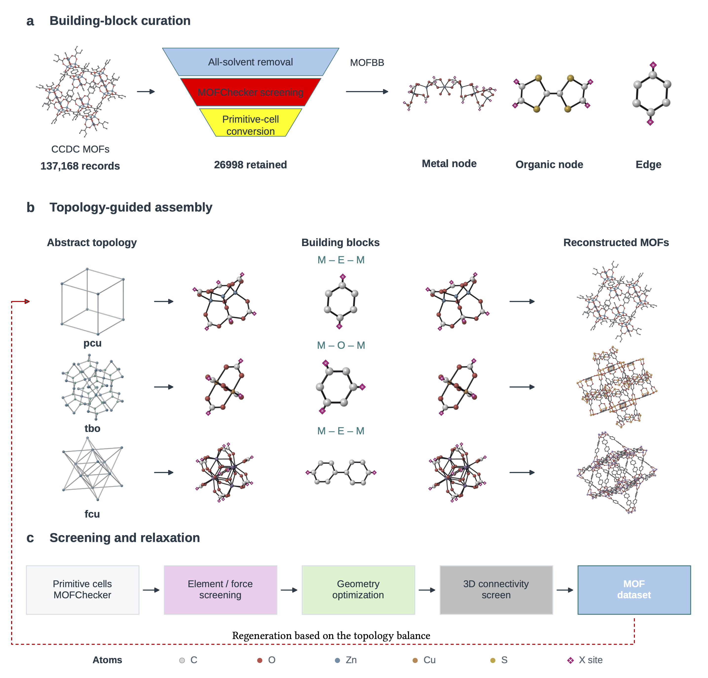

# MOFBB

Extract reusable building blocks from metal–organic frameworks (MOFs) and
assemble them into new MOFs with this Python toolkit.

<p align="center">

  

</p>

## Install

Requires **Python 3.10+**. From the repository directory:

```bash
pip install uv
uv venv .venv --python 3.10
source .venv/bin/activate
uv pip install -e .
```

Alternatively, install with pip in your existing environment:

```bash
python -m pip install -e .
```
## Basic functions
1. Extract Secondary building blocks from given MOF structure.
2. Build a novel MOF with given topology and secondary building blocks
3. Find available SBUs with given topology.
### Extract building blocks

```bash
mofbb-decompose structure.cif \
  --output-dir outputs/structure \
  --write-topology
```

Outputs include metal nodes, organic nodes, and linker edges as XYZ files:

- `bbs/`: one reusable representative per fragment group.
- `decomposition_summary.json`: fragment counts, groups, and file paths.
- `topology.cgd`: the periodic net, saved with `--write-topology`.

Cut bonds are capped with dummy `X` atoms for assembly. Solvent is kept by
default; add `--solvent-mode free` or `--solvent-mode all` to remove it.


> [!NOTE]
>
> You can either extract the building blocks with your dataset, or directly build MOFs with our curated building blocks library:
> https://huggingface.co/datasets/Harrison-Li/BMOFs
> 
> We also provided the balanced hypothetical MOFs (bMOFs): Release in a few days.

### Build a new MOF

Choose a CGD topology and your building blocks. Replace these example filenames
and type IDs with your own:

```bash
mofbb-compose topology.cgd \
  --node-bb 0=node_type_0.xyz \
  --node-bb 1=node_type_1.xyz \
  --edge-bb 0,1=edge_type_0_1.xyz \
  --output outputs/new_mof.cif
```

Assign a block to every node type. CLI types start at `0` (`NODE 1` in CGD maps
to type `0`), and each node block needs one `X` site per connection. Edge blocks
are optional; omitted edges connect nodes directly.

```python
from mofbb.compose import Builder, Edge, Node, Topology

topology = Topology("topology.cgd")
builder = Builder()
framework = builder.build(
    topology,
    node_bbs={0: Node("node_type_0.xyz")},
    # edge_bbs={(0, 0): Edge("edge_type_0_0.xyz")},  # optional linker
    port_tol=0.3,  # maximum paired-port gap in angstroms
    bond_scale=1.2,  # bond cutoff multiplier for summed covalent radii
    sym_tol=0.1,  # site-symmetry compatibility tolerance in angstroms
)
```

`Node.kind` detects `metal_node` or `organic_node` from the real atoms

### Find available SBUs with an abstract topology

```python
from mofbb.compose import Topology

topology = Topology("/nanolab/libo/mof_builder/lib/topology/pcu.cgd")
bbs = topology.find_avail_bbs("/nanolab/libo/mof_builder/lib")
# {"m_nodes": [...], "o_nodes": [...], "edges": [...]}
# Each list contains absolute XYZ file paths.
```

## Quick start

Download the [building-block library](https://huggingface.co/datasets/Harrison-Li/BMOFs)
and set `library` to its local directory, containing `topology/`, `node/`,
and `edge/`. This example uses `tbo`: node type `0` is three-connected
(assigned an organic node), node type `1` is four-connected (assigned a metal
node), and edge type `(0, 1)` optionally takes a linker.

```python
import random
from pathlib import Path
from mofbb.compose import Builder, Edge, Node, Topology

library = Path("/path/to/library")

# 1. Load an abstract topology.
topology = Topology(library / "topology" / "tbo.cgd")

# 2. Find geometrically compatible building blocks.
bbs = topology.find_avail_bbs(library)
print({kind: len(paths) for kind, paths in bbs.items()})
# {"m_nodes": ..., "o_nodes": ..., "edges": ...}

# 3. Enumerate metal/organic node pairs and randomly include an edge.
output = Path("outputs/tbo")
output.mkdir(parents=True, exist_ok=True)
builder = Builder()

idx = 0
for metal_path in bbs["m_nodes"]:
    metal_node = Node(metal_path)
    if metal_node.n_ports != 4:
        continue
    for organic_path in bbs["o_nodes"]:
        organic_node = Node(organic_path)
        if organic_node.n_ports != 3:
            continue
        idx += 1
        # m_node + o_node + optional edge
        edge_bbs = {}
        if random.randint(0, 1) == 1:
            edge_path = random.choice(bbs["edges"])
            edge_bbs = {(0, 1): Edge(edge_path)}
        try:
            framework = builder.build(
                topology,
                node_bbs={0: organic_node, 1: metal_node},
                edge_bbs=edge_bbs,
            )
        except ValueError as error:
            print(f"Skipped combination {idx}: {error}")
            continue
        framework.write_cif(output / f"tbo_{idx:06d}.cif")
```


## Validate a CIF

```bash
python -m mofbb.compose.validate outputs/new_mof.cif
```

Checks 3D connectivity from coordinates. Add `--single-linker` to require one
organic linker type. Exit status is `0` on success and `1` on failure. Recheck
structures after external geometry optimization.

## Generate multiple MOFs

```bash
python scripts/generate_unique_mofs.py \
  --library /path/to/library \
  --output /path/to/new_run \
  --count 10
```

The library needs `building_blocks_manifest.csv` and a `topology/` directory.

## Help

```bash
mofbb-decompose --help
mofbb-compose --help
python -m mofbb.compose.validate --help
```
