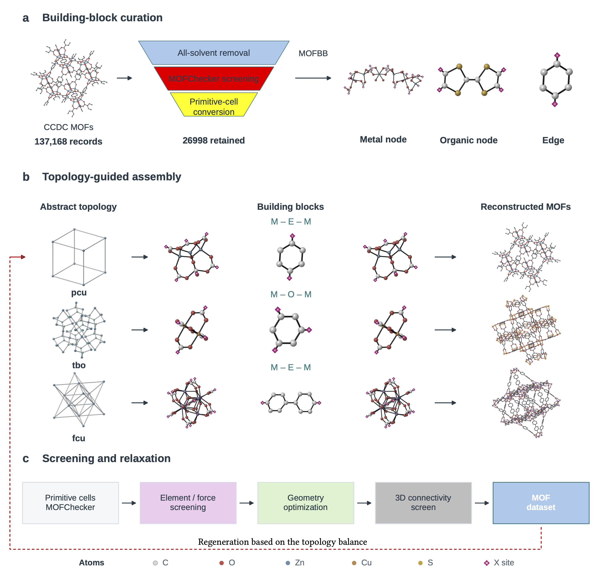

# MOFBB

Extract reusable building blocks from metal–organic frameworks (MOFs) and
assemble them into new MOFs with this Python toolkit.

<p align="center">

  

</p>

## Install

Requires **Python 3.10+**. From the repository directory:

```bash
pip install uv
uv venv .venv --python 3.10
source .venv/bin/activate
uv pip install -e .
```

Alternatively, install with pip in your existing environment:

```bash
python -m pip install -e .
```

## Extract building blocks

```bash
mofbb-decompose structure.cif \
  --output-dir outputs/structure \
  --write-topology
```

Outputs include metal nodes, organic nodes, and linker edges as XYZ files:

- `bbs/`: one reusable representative per fragment group.
- `decomposition_summary.json`: fragment counts, groups, and file paths.
- `topology.cgd`: the periodic net, saved with `--write-topology`.

Cut bonds are capped with dummy `X` atoms for assembly. Solvent is kept by
default; add `--solvent-mode free` or `--solvent-mode all` to remove it.


> [!NOTE]
>
> You can either extract the building blocks with your dataset, or directly build MOFs with our curated building blocks library:
> https://huggingface.co/datasets/Harrison-Li/BMOFs
> 
> We also provided the balanced hypothetical MOFs (bMOFs): Release in a few days.


## Build a new MOF

Choose a CGD topology and your building blocks. Replace these example filenames
and type IDs with your own:

```bash
mofbb-compose topology.cgd \
  --node-bb 0=node_type_0.xyz \
  --node-bb 1=node_type_1.xyz \
  --edge-bb 0,1=edge_type_0_1.xyz \
  --output outputs/new_mof.cif
```

Assign a block to every node type. CLI types start at `0` (`NODE 1` in CGD maps
to type `0`), and each node block needs one `X` site per connection. Edge blocks
are optional; omitted edges connect nodes directly.

```python
from mofbb.compose import Builder, BuildingBlock, Topology

topology = Topology("topology.cgd")
framework = Builder().build_by_type(
    topology,
    node_bbs={0: BuildingBlock("node_type_0.xyz")},
    port_tol=0.3, # permutation loss tolerance
    bond_scale=1.2, # maximum created bond < atom raddi
    sym_tol=0.1, # compatible symmetry tolerance of building blocks which has operation with annouced topology
    #n_angles=6, # interval for searching best permuation between [0, 360]
)
```

## Validate a CIF

```bash
python -m mofbb.compose.validate outputs/new_mof.cif
```

Checks 3D connectivity from coordinates. Add `--single-linker` to require one
organic linker type. Exit status is `0` on success and `1` on failure. Recheck
structures after external geometry optimization.

## Generate multiple MOFs

```bash
python scripts/generate_unique_mofs.py \
  --library /path/to/library \
  --output /path/to/new_run \
  --count 10
```

The library needs `building_blocks_manifest.csv` and a `topology/` directory.
The launcher excludes duplicates using the local `2m_mofs_v2` database and its
archives; use `--history /path/to/generation.sqlite3` for another history database.
Checks use assignment signatures and exact CIF hashes. Use a fresh output
folder when changing the library or validation policy.

## Help

```bash
mofbb-decompose --help
mofbb-compose --help
python -m mofbb.compose.validate --help
```

See [`examples/`](examples/) for sample building blocks and topologies.
